<!-- Modified: 2026-08-18 -->
# nPort RF Analysis

nPort RF Analysis embeds RF and microwave network analysis in Obsidian Markdown notes. It runs verbatim nP JavaScript on demand and retains declarative JSON blocks for safe automatic rendering. Results appear as inline SVG line charts, Smith charts, or tables.

The plugin currently supports the Obsidian desktop application. Mobile support will be declared only after it has been tested on Obsidian Mobile.

## Installation

After the plugin is published in the Obsidian Community Plugin directory:

1. Open **Settings → Community plugins** in the vault where you want to use it.
2. Select **Browse**, search for **nPort RF Analysis**, and select **Install**.
3. Select **Enable**.

For a manual installation, download `main.js`, `manifest.json`, and `styles.css` from the GitHub release whose tag matches the version in `manifest.json`. Place the three files in:

```text
<vault>/.obsidian/plugins/np-rf-analysis/
```

Restart Obsidian, then enable **nPort RF Analysis** under **Settings → Community plugins**. Plugins are installed and enabled separately for each vault.

To add the bundled lessons and runnable examples, open **Settings → Community plugins → nPort RF Analysis** and select **Create learning guide**. The plugin creates the self-contained `Getting Started` folder in the current vault, adds only missing lesson and SVG diagram files, preserves existing files, and opens the first lesson.

The current release provides the smaller `Getting Started` collection. The
full numbered learning sequence and converted historical Examples collection
are maintained and tested separately while their repeatable promotion and
bundle validation are completed; they are not yet created by the released
plugin.

## Verbatim JavaScript

Use an `npjs` block for the full nP JavaScript API. The source is executed without translation after you select **Run**.

````markdown
```npjs
var g = nP.global;
g.fList = g.fGen(100e6, 1000e6, 51);

var r1 = nP.R(25);
var l1 = nP.L(2e-9);

var network = nP.nodal(
    [r1, 1, 2],
    [l1, 2, 3],
    ['out', 1, 3]
);

var output = network.out('s11dB', 's21dB');
nP.lineChart({
    inputTable: [output],
    title: 'Network response',
    mount: '#chartDiv',
    backgroundColor: 'white'
});
```
````

Each block provides **Run**, **Stop**, and **Reset** controls:

- **Run** starts a fresh isolated execution and clears results from the previous run.
- **Stop** terminates the worker immediately and leaves results already rendered.
- **Reset** terminates execution and clears charts, tables, messages, and errors.

Successful results are saved as validated render instructions and restored when the note is rendered again. This lets Obsidian include charts, tables, and text results in **Export to PDF** without automatically rerunning JavaScript. Changing the JavaScript invalidates the saved result; run the updated block once to create a new snapshot. During PDF export, interactive controls and the security warning are hidden.

Saved results have a bounded cache lifecycle:

- Editing or deleting an `npjs` block removes its previous saved result.
- Deleting a note removes results owned by that note; renaming a note transfers their ownership to the new path.
- Results older than 30 days are removed by default.
- Saved-result storage is limited to 25 MB by default, with the oldest results removed first.
- Both limits are configurable under **Settings → Community plugins → nPort RF Analysis**.
- The settings page shows the current result count and approximate storage size and provides **Clear saved results**.
- The command palette also provides **nPort RF Analysis: Clear saved results**.
- Optional session-only mode clears saved results during a normal Obsidian quit. This is best-effort cleanup and cannot run after a crash or forced shutdown.

The cache is stored in the plugin's `data.json`; result data is not inserted into the Markdown note.

Inside an `npjs` fence, ordinary paste uses the clipboard's plain-text representation. JavaScript copied from editors such as VS Code therefore keeps its intended spaces, tabs, and line breaks without importing rich-text paragraph formatting.

In Reading view, the controls and `Status: Ready` appear above the complete, always-visible JavaScript source. Charts, tables, messages, and errors appear below the source.

Selectors such as `mount: '#chartDiv'` are resolved within that block, so existing nP development scripts can be pasted without adding HTML mount elements. `nP.lineChart()`, `nP.smithChart()`, and `nP.lineTable()` render in the note; all nP analysis constructors and composition functions remain available to the script.

## Optional declarative JSON

Use an `np` block when a validated, automatically rendered analysis is preferable:

````markdown
```np
{
  "frequencies": {
    "start": 100000000,
    "stop": 6000000000,
    "points": 101,
    "referenceImpedance": 50
  },
  "components": {
    "r1": { "type": "R", "value": 25 },
    "l1": { "type": "L", "value": 2e-9 }
  },
  "nodal": [
    ["r1", 1, 2],
    ["l1", 2, 3],
    ["out", 1, 3]
  ],
  "output": ["s11dB", "s21dB"],
  "view": {
    "type": "line",
    "title": "Series R-L response",
    "metricPrefix": "giga"
  }
}
```
````

Switch to Reading View to render the analysis.

## Security model

`npjs` deliberately executes user-authored JavaScript, but it does not run automatically. Only select **Run** for code you trust.

- Execution occurs in a disposable Web Worker inside a sandboxed iframe.
- The iframe applies a Content Security Policy that denies network connections and remote resources.
- Network, browser storage, and nested-worker APIs are disabled inside the worker.
- The script receives nP, a captured console, chart/table forwarding, and a text-only `document.getElementById(...).textContent` compatibility shim. It does not receive Obsidian's `app`, vault, actual DOM, Node.js, Electron, `require`, or `process` objects.
- Stopping, resetting, unloading the block, or completing a run destroys the execution context.
- The plugin contains no telemetry, remote code loading, self-update mechanism, or access to files outside the vault.

The safe `np` JSON format remains available and never executes JavaScript.

Security reports may be submitted through the repository's GitHub issues. Do not include private vault contents in a report. See `SECURITY.md` for the supported-version and reporting policy.

## Support and feedback

For questions, bug reports, and feature requests, [open an issue in the GitHub repository](https://github.com/JerryWiltz/np-rf-analysis/issues). Do not include private vault contents, credentials, or other sensitive information.

The plugin settings page provides **Create learning guide**, **Open documentation**, and **Report an issue** buttons. Creating the guide writes the disclosed lesson files only inside the current vault. The other two buttons open GitHub in the default browser only after you select them; the plugin makes no background network requests.

## Supported features

- Frequency ranges, reference impedance, and temperature.
- `R`, `L`, `C`, `seR`, `seL`, `seC`, `paR`, `paL`, `paC`, `Tee`, `Open`, `Short`, `Load`, and `Tlin` components.
- Explicit `nP.nodal()` topology.
- All `.out(...)` suffixes: `mag`, `dB`, `ang`, `Re`, and `Im`.
- Line charts, Smith charts, and SVG tables.
- Light and dark theme-aware containers.
- Isolated nP global analysis settings for every block.
- Verbatim nP JavaScript with explicit Run, Stop, and Reset controls.
- Optional JSON validation without JavaScript execution.

For a Smith chart, request paired real and imaginary outputs and set `view.type` to `smith`:

```json
"output": ["s11Re", "s11Im"],
"view": { "type": "smith", "title": "Input match" }
```

## Local development

The prototype includes a pinned, generated nP ESM bundle under `vendor/` so releases and CI are self-contained. The vendored bundle is generated from the nP `0.0.48` plugin entry and remains covered by nP's MIT license. That entry contains the complete RF, math, component, diode, chart, and table APIs, but intentionally excludes nP's obsolete browser-development helpers. The worker is bundled into `main.js`; the plugin does not download executable code at runtime.

### Bundled learning and example content

Educational content is authored and verified in the dedicated
`np-rf-analysis-test-vault`, then promoted into reviewable Markdown and SVG
source assets in this repository. The production build embeds those source
assets into `main.js`; users do not need the authoring vault, an AI CLI, or a
network connection to create and use the bundled material.

The intended complete bundle contains Lessons 1–22, reference notes 100 and
200, the converted Examples hierarchy, and every real SVG referenced by those
notes. Administrative files such as `AGENTS.md` are excluded. The
`my-circuit.svg` name shown in lesson 22 is placeholder code, not a required
asset.

Promotion must preserve internal paths and must verify that all intended files
are present and all real SVG references resolve. Generated `main.js` remains
ignored source output; Markdown and SVG files, the promotion procedure, and
the validation tests remain reviewable in the repository. Content creation in
a user's vault adds only missing files by default and does not overwrite the
user's edits.

During coordinated nP development, the repositories can still be kept as siblings:

```text
parent/
├── nP/
└── np-rf-analysis/
```

Build and test with:

```sh
npm install
npm run typecheck
npm test
npm run build
```

For manual Obsidian testing, copy or link this directory into a dedicated test vault as:

```text
<test-vault>/.obsidian/plugins/np-rf-analysis/
```

Obsidian loads `manifest.json`, `main.js`, and `styles.css`. Do not develop against an important vault.

## Complete nP API reference

The following reference is maintained from lesson 200 of the learning guide and covers the public API bundled with the versions identified below.

### Version Covered

This list applies to:

- **nP library:** `0.0.48`
- **nPort RF Analysis Obsidian plugin:** `0.3.2`
- **Reference updated:** 2026-08-18

The two version numbers are independent. The plugin has its own release version and bundles a particular version of the nP library.

This reference was audited against the public export list and returned-object APIs in the nP module bundled with plugin `0.3.2`. It covers every public export in nP `0.0.48`; internal implementation helpers are outside its scope.

Display the bundled nP version in the console pane with:

```npjs
console.log("nP version " + nP.version);
```

Expected console output:

```text
[log] nP version 0.0.48
```

When the bundled nP version changes, re-audit the export list, signatures, defaults, returned members, and runnable examples before updating this version statement.

### Constructor Conventions

Set the frequency list before calling an RF constructor:

```javascript
var g = nP.global;
g.fList = g.fGen(1e9, 10e9, 11);
```

Unless stated otherwise:

- Resistance is in ohms.
- Inductance is in henries.
- Capacitance is in farads.
- Frequency is in hertz.
- Physical dimensions are in meters.
- Constructors use `nP.global.fList`, `nP.global.Ro`, and, when applicable, `nP.global.Temp`.
- RF constructors return n-port objects containing S-parameters for every active frequency.
- A displayed default is the value used when that argument or option is omitted.

In the constructor tables, **Chainable: Yes** means the constructor returns a two-port that can validly continue with `.cas(nextTwoPort)`. See [Method Chaining](#method-chaining) for the complete rules and examples.

### Basic RLC Constructors

The uppercase short names are the preferred constructors for ordinary explicit circuit descriptions.

| Constructor | Signature | Ports | Description | Chainable |
| --- | --- | ---: | --- | :---: |
| `nP.R()` | `(R = 75)` | 2 | Series resistor. | Yes |
| `nP.L()` | `(L = 5e-9)` | 2 | Series inductor. | Yes |
| `nP.C()` | `(C = 1e-12)` | 2 | Series capacitor. | Yes |
| `nP.seR()` | `(R = 75)` | 2 | Explicitly named series resistor; equivalent role to `R()`. | Yes |
| `nP.seL()` | `(L = 5e-9)` | 2 | Explicitly named series inductor; equivalent role to `L()`. | Yes |
| `nP.seC()` | `(C = 1e-12)` | 2 | Explicitly named series capacitor; equivalent role to `C()`. | Yes |
| `nP.paR()` | `(R = 75)` | 2 | Shunt resistor. | Yes |
| `nP.paL()` | `(L = 5e-9)` | 2 | Shunt inductor. | Yes |
| `nP.paC()` | `(C = 1e-12)` | 2 | Shunt capacitor. | Yes |

> **Basic RLC example**
> ```javascript
> var r1 = nP.R(75);
> var l1 = nP.L(5e-9);
> var c1 = nP.C(1e-12);
> ```

#### Basic RLC Symbols

This visual catalog uses the preferred explicit constructors.

> **Canonical RLC symbols**
> | Constructor | Canonical symbol |
> | --- | --- |
> | `nP.R()` | 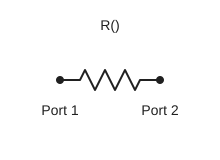 |
> | `nP.L()` | 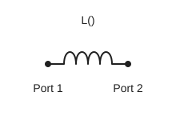 |
> | `nP.C()` | 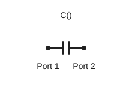 |

### Combined RLC Constructors

The combined-constructor names contain two topology prefixes:

- The first `se` or `pa` says whether the completed equivalent impedance is placed in the two-port's **series path** or as a **shunt branch**.
- The second `Se` or `Pa` says whether the R, L, and C elements are internally combined in **series** or **parallel**.

For example, `sePaRC()` places a parallel-RC equivalent impedance in the two-port's series path. `paSeRC()` places a series-RC branch in shunt.

#### Internally Series Elements

| Constructor | Signature | Ports | Description | Chainable |
| --- | --- | ---: | --- | :---: |
| `nP.seSeRL()` | `(R = 75, L = 5e-9)` | 2 | Series-RL impedance in the two-port series path. | Yes |
| `nP.paSeRL()` | `(R = 75, L = 5e-9)` | 2 | Series-RL impedance as a shunt branch. | Yes |
| `nP.seSeRC()` | `(R = 75, C = 1e-12)` | 2 | Series-RC impedance in the two-port series path. | Yes |
| `nP.paSeRC()` | `(R = 75, C = 1e-12)` | 2 | Series-RC impedance as a shunt branch. | Yes |
| `nP.seSeLC()` | `(L = 5e-9, C = 1e-12)` | 2 | Series-LC impedance in the two-port series path. | Yes |
| `nP.paSeLC()` | `(L = 5e-9, C = 1e-12)` | 2 | Series-LC impedance as a shunt branch. | Yes |
| `nP.seSeRLC()` | `(R = 75, L = 5e-9, C = 1e-12)` | 2 | Series-RLC impedance in the two-port series path. | Yes |
| `nP.paSeRLC()` | `(R = 75, L = 5e-9, C = 1e-12)` | 2 | Series-RLC impedance as a shunt branch. | Yes |

#### Internally Parallel Elements

| Constructor | Signature | Ports | Description | Chainable |
| --- | --- | ---: | --- | :---: |
| `nP.sePaRL()` | `(R = 75, L = 5e-9)` | 2 | Parallel-RL impedance in the two-port series path. | Yes |
| `nP.paPaRL()` | `(R = 75, L = 5e-9)` | 2 | Parallel-RL impedance as a shunt branch. | Yes |
| `nP.sePaRC()` | `(R = 75, C = 1e-12)` | 2 | Parallel-RC impedance in the two-port series path. | Yes |
| `nP.paPaRC()` | `(R = 75, C = 1e-12)` | 2 | Parallel-RC impedance as a shunt branch. | Yes |
| `nP.sePaLC()` | `(L = 5e-9, C = 1e-12)` | 2 | Parallel-LC impedance in the two-port series path. | Yes |
| `nP.paPaLC()` | `(L = 5e-9, C = 1e-12)` | 2 | Parallel-LC impedance as a shunt branch. | Yes |
| `nP.sePaRLC()` | `(R = 75, L = 5e-9, C = 1e-12)` | 2 | Parallel-RLC impedance in the two-port series path. | Yes |
| `nP.paPaRLC()` | `(R = 75, L = 5e-9, C = 1e-12)` | 2 | Parallel-RLC impedance as a shunt branch. | Yes |

For instructional circuits and arbitrary topologies, explicit `R()`, `L()`, and `C()` components connected with `nP.nodal()` usually make the circuit easier to read.

The combined RLC constructors intentionally have no symbol-library entries. Their internal combinations are clearer when drawn and coded as explicit components connected with `nP.nodal()`.

### Transformer Constructors

| Constructor | Signature | Ports | Description | Chainable |
| --- | --- | ---: | --- | :---: |
| `nP.trf()` | `(N = 0.5)` | 2 | Ideal two-port transformer model. | Yes |
| `nP.trf4Port()` | `(N = 0.5)` | 4 | Ideal four-port transformer model. | No |

`N` is the transformer turns-ratio parameter used by the model.

> **Canonical transformer symbols**
> | Constructor | Canonical symbol |
> | --- | --- |
> | `nP.trf()` | 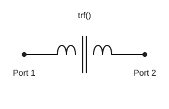 |
> | `nP.trf4Port()` | 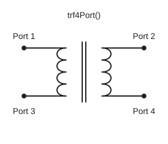 |

For `trf4Port()`, ports 1 and 3 are the primary pair and ports 2 and 4 are the secondary pair.

### Ideal Components and Junctions

Ideal component names begin with an uppercase letter.

| Constructor | Signature | Ports | Description | Chainable |
| --- | --- | ---: | --- | :---: |
| `nP.Open()` | `()` | 1 | Ideal open circuit. | No |
| `nP.Short()` | `()` | 1 | Ideal short circuit. | No |
| `nP.Load()` | `()` | 1 | Ideal matched load. | No |
| `nP.Shift90()` | `()` | 2 | Matched lossless two-port with +90° through phase. | Yes |
| `nP.Tee()` | `()` | 3 | Ideal three-port junction. | No |
| `nP.seriesTee()` | `()` | 3 | Ideal series junction: ports 1 and 2 form the through path; port 3 accepts a one-port series branch. | No |
| `nP.Tee4()` | `()` | 4 | Ideal four-port junction. | No |
| `nP.Tee5()` | `()` | 5 | Ideal five-port junction. | No |
| `nP.Tlin()` | `(Z = 60, Length = 0.0127)` | 2 | Ideal lossless transmission line. | Yes |
| `nP.Tclin()` | `(Zoe = 100, Zoo = 30, Length = 0.037338)` | 4 | Ideal lossless coupled transmission line. | No |

For `Tlin()`, `Z` is characteristic impedance and `Length` is physical length. For `Tclin()`, `Zoe` and `Zoo` are the even- and odd-mode impedances.

> **Canonical ideal-component symbols**
> | Constructor | Canonical symbol |
> | --- | --- |
> | `nP.Open()` | 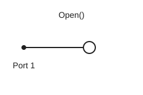 |
> | `nP.Short()` | 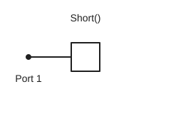 |
> | `nP.Load()` | 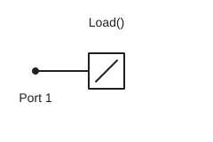 |
> | `nP.Shift90()` | 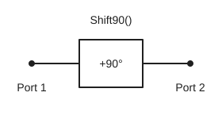 |
> | `nP.Tee()` | 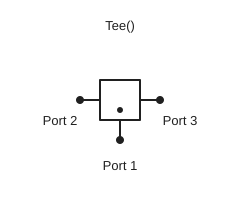 |
> | `nP.Tee4()` | 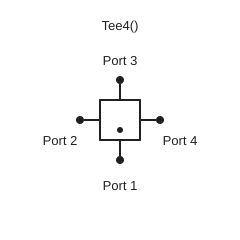 |
> | `nP.Tee5()` | 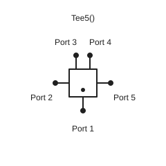 |
> | `nP.Tlin()` | 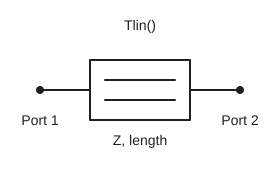 |
> | `nP.Tclin()` | 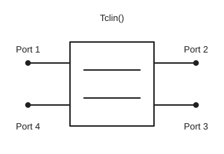 |

Coupled-line ports are numbered clockwise:

```text
port 1  ─── coupled line ─── port 2
port 4  ─── coupled line ─── port 3
```

### Physical Transmission-Media Constructors

Physical transmission-media constructors are organized by their modeling family. The current library provides the microstrip `mlin` family. Future stripline, coaxial, and waveguide families can be added here as peer sections without being grouped under a JavaScript argument style.

#### Microstrip: the `mlin` Constructor Family

All current microstrip component implementations belong to the `mlin` source family. Their public constructor names are lowercase, and physical dimensions are in meters.

| Constructor | Signature | Ports | Description | Chainable |
| --- | --- | ---: | --- | :---: |
| `nP.mlin()` | `(Width, Height, Length, Thickness, er, rho, tand, roughnessRms)` | 2 | Physical microstrip transmission line. | Yes |
| `nP.mclin()` | `(Width, Space, Height, Thickness, Length, er, rho, tand, roughnessRms)` | 4 | Physical coupled microstrip line. | No |
| `nP.mtee()` | `(commonWidth, branch1Width, branch2Width, Height, Thickness, er, rho, tand, roughnessRms)` | 3 | Physical microstrip tee junction. | No |
| `nP.mcross()` | `(options)` | 4 | Physical microstrip cross junction. | No |
| `nP.mstep()` | `(options)` | 2 | Physical microstrip width step. | Yes |
| `nP.mbend()` | `(options)` | 2 | Physical microstrip bend. | Yes |
| `nP.mtfr()` | `(options)` | 2 | Distributed microstrip thin-film resistor. | Yes |
| `nP.mvgnd()` | `(options)` | 1 | Physical via-to-ground model. | No |
| `nP.mvia()` | `(options)` | 2 | Physical via transition between conductor layers. | Yes |

> **Microstrip signatures, options, and `mtee()` defaults**
> **Positional-argument constructors**
>
> ```javascript
> nP.mlin(
>     Width = 0.023 * 0.0254,
>     Height = 0.025 * 0.0254,
>     Length = 0.5 * 0.0254,
>     Thickness = 0.0000125 * 0.0254,
>     er = 10,
>     rho = 1,
>     tand = 0.001,
>     roughnessRms = 0
> )
>
> nP.mclin(
>     Width = 19.1155 * 0.001 * 0.0254,
>     Space = 5.82185 * 0.001 * 0.0254,
>     Height = 25 * 0.001 * 0.0254,
>     Thickness = 0.0000125 * 0.0254,
>     Length = 719.794 * 0.001 * 0.0254,
>     er = 10,
>     rho = 1,
>     tand = 0.001,
>     roughnessRms = 0
> )
> ```
>
> For `mlin()` and `mclin()`, `rho` is a resistivity multiplier relative to copper. A value of `0` disables conductor loss. `mclin()` uses the same clockwise port convention as `Tclin()`.
>
> **Options-object defaults**
>
> ```javascript
> nP.mtee(
>     0.023 * 0.0254,
>     0.023 * 0.0254,
>     0.023 * 0.0254,
>     0.025 * 0.0254,
>     0.0000125 * 0.0254,
>     10,
>     1,
>     0.001,
>     0
> )
>
> nP.mcross({
>     leftWidth: 0.023 * 0.0254,
>     topWidth: 0.023 * 0.0254,
>     rightWidth: 0.023 * 0.0254,
>     bottomWidth: 0.023 * 0.0254,
>     Height: 0.025 * 0.0254,
>     Thickness: 0.0000125 * 0.0254,
>     er: 10, rho: 1, tand: 0.001, roughnessRms: 0
> })
>
> nP.mstep({
>     width1: 0.046 * 0.0254,
>     width2: 0.023 * 0.0254,
>     Height: 0.025 * 0.0254,
>     Thickness: 0.0000125 * 0.0254,
>     er: 10, rho: 1, tand: 0.001, roughnessRms: 0
> })
>
> nP.mbend({
>     Width: 0.023 * 0.0254,
>     miterLength: 0,
>     Height: 0.025 * 0.0254,
>     Thickness: 0.0000125 * 0.0254,
>     er: 10, rho: 1, tand: 0.001, roughnessRms: 0
> })
>
> nP.mtfr({
>     ohmsPerSquare: 50,
>     Width: 10 * 0.001 * 0.0254,
>     Length: 10 * 0.001 * 0.0254,
>     Height: 0.025 * 0.0254,
>     Thickness: 0.0000125 * 0.0254,
>     er: 10,
>     tand: 0.001,
>     temperatureCoefficient: 0,
>     temperatureReference: 25,
>     sections: undefined
> })
>
> nP.mvgnd({
>     Diameter: 100e-6,
>     Height: 0.025 * 0.0254,
>     Thickness: 0.0000125 * 0.0254,
>     rho: 1.72e-8
> })
>
> nP.mvia({
>     Diameter: 100e-6,
>     connectionHeight: 0.025 * 0.0254,
>     Thickness: 0.0000125 * 0.0254,
>     rho: 1.72e-8,
>     er: 10,
>     padDiameter: 0,
>     antipadDiameter: 0,
>     topPadHeight: 0,
>     bottomPadHeight: 0,
>     topStubLength: 0,
>     bottomStubLength: 0
> })
> ```
>
> `mvgnd()` and `mvia()` use absolute conductor resistivity in Ω·m, not the relative `rho` multiplier used by `mlin()` and `mclin()`. For `mtfr()`, `sections = automatic` means nP selects `Math.min(200, Math.max(10, Math.ceil((Length / Width) * 10)))`; an explicitly supplied value is floored and clamped to at least `1`.
>
> **`nP.mtee(commonWidth, branch1Width, branch2Width, Height, Thickness, er, rho, tand, roughnessRms)`**
>
> `mtee()` calculates a physical three-port junction discontinuity from the three arm widths and substrate geometry. Omitted positional arguments use the defaults below. The earlier options-object form remains supported for backward compatibility.
>
> | Parameter | Default | Meaning |
> | --- | ---: | --- |
> | `commonWidth` | `0.023 * 0.0254` m = `0.5842 mm` | Width of the common arm connected to port 1. |
> | `branch1Width` | `0.023 * 0.0254` m = `0.5842 mm` | Width of the first branch connected to port 2. |
> | `branch2Width` | `0.023 * 0.0254` m = `0.5842 mm` | Width of the second branch connected to port 3. |
> | `Height` | `0.025 * 0.0254` m = `0.635 mm` | Substrate height between the trace and its reference plane. |
> | `Thickness` | `0.0000125 * 0.0254` m = `0.3175 µm` | Metal thickness. |
> | `er` | `10` | Relative permittivity, also called the dielectric constant. |
> | `rho` | `1` | Conductor-resistivity multiplier relative to copper. |
> | `tand` | `0.001` | Dielectric loss tangent. |
> | `roughnessRms` | `0` m | RMS conductor-surface roughness; zero represents a smooth conductor. |
>
> **Ports:** port 1 is the common arm, port 2 is branch 1, and port 3 is branch 2.
>
> JavaScript capitalization matters: use `Height` and `Thickness` with uppercase first letters. Set `nP.global.fList` before constructing the tee.
>
> In nP `0.0.48`, the tee-junction calculation uses the three widths, `Height`, `Thickness`, and `er`. It records `rho`, `tand`, and `roughnessRms` in `.microstrip`, but those parameters do not add loss inside the junction model. Connected `mlin()` sections model their own transmission-line losses.

The physical constructors expose model metadata in addition to the ordinary n-port members:

| Constructors | Additional returned member |
| --- | --- |
| `mlin`, `mclin`, `mtee`, `mcross`, `mstep`, `mbend`, `mvgnd`, `mvia` | `.microstrip`, containing input geometry and model-specific calculated data. |
| `mtfr` | `.filmResistor`, containing geometry, resistance, section count, and temperature data. |
| `mtee`, `mcross` | `.Ct`, the junction capacitance also recorded inside `.microstrip`. |

`mtee()`, `mcross()`, `mstep()`, and `mbend()` are discontinuity models rather than finite-length lossy lines. In nP `0.0.48`, their `rho`, `tand`, and `roughnessRms` parameters or options are retained as metadata but do not add conductor, dielectric, or roughness loss to the discontinuity itself.

##### `mlin` Family Symbols

> **Canonical microstrip symbols**
> | Constructor | Canonical symbol |
> | --- | --- |
> | `nP.mlin()` | 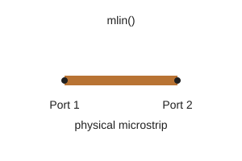 |
> | `nP.mclin()` | 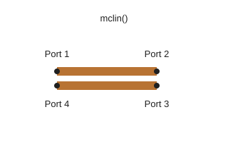 |
> | `nP.mtee()` | 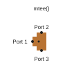 |
> | `nP.mcross()` | 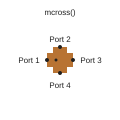 |
> | `nP.mstep()` | 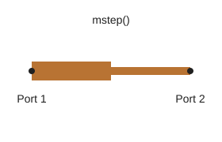 |
> | `nP.mbend()` right turn | 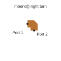 |
> | `nP.mbend()` left turn | 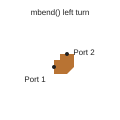 |
> | `nP.mtfr()` | 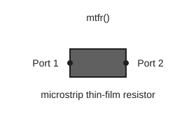 |
> | `nP.mvgnd()` | 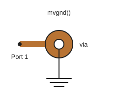 |
> | `nP.mvia()` | 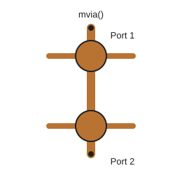 |

### Diode Constructor

| Constructor | Signature | Ports | Description | Chainable |
| --- | --- | ---: | --- | :---: |
| `nP.diode1N4148()` | `(options)` | 2 | Small-signal RF diode model with Shockley DC I-V behavior. | Yes |

The returned object is an n-port and also provides:

- `.diode` for model parameters, bias results, and model provenance.
- `.ivTable(start, stop, points)` for a DC voltage/current table.

> **Diode options**
> | Option | Default | Meaning |
> | --- | ---: | --- |
> | `is` | `2.75e-11` A | Saturation current. |
> | `n` | `2` | Emission coefficient. |
> | `rs` | `0.568` Ω | Series resistance. |
> | `cj0` | `4e-12` F | Zero-bias junction capacitance. |
> | `vj` | `0.75` V | Junction potential. |
> | `m` | `0.5` | Junction grading coefficient. |
> | `tt` | `4e-9` s | Transit time. |
> | `leakageResistance` | `4e9` Ω | Parallel leakage resistance. |
> | `breakdownVoltage` | `100` V | Reverse-breakdown voltage magnitude. |
> | `breakdownCurrent` | `100e-6` A | Breakdown-current scale. |
> | `breakdownSoftness` | `2` V | Exponential breakdown-voltage scale. |
> | `biasVoltage` | `0` V | DC bias used for the RF small-signal model. |
> | `temperatureK` | `nP.global.Temp` | Junction temperature in kelvins. |
> | `ivStart` | `-110` V | Default starting voltage for `.ivTable()`. |
> | `ivStop` | `1` V | Default stopping voltage for `.ivTable()`. |
> | `ivPoints` | `401` | Default number of `.ivTable()` rows, excluding the header. |
>
> 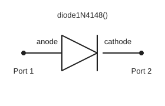

### Low-Pass Network Constructor

| Constructor | Signature | Ports | Description | Chainable |
| --- | --- | ---: | --- | :---: |
| `nP.lpfGen()` | `(filt = defaultFilter)` | 2 | Low-pass two-port synthesized from an alternating termination/component value array. | Yes |

New instructional examples should normally show the individual components and their `nP.nodal()` connections when circuit topology matters.

The default filter array is:

```javascript
[50, 1.641818746502858e-11, 4.565360855435164e-8, 1.6418187465028578e-11, 50]
```

`lpfGen()` removes the first and last termination values from the supplied `filt` array with `shift()` and `pop()`. Pass `filt.slice()` when the caller must preserve the original array:

```javascript
var filter = nP.lpfGen(filterValues.slice());
```

#### Chebyshev Low-Pass Design Helpers

These helpers calculate the section count, normalized prototype values, and physical component values used to build a Chebyshev low-pass network:

| Helper | Signature | Returns | Chainable |
| --- | --- | --- | :---: |
| `nP.chebyLPNsec()` | `(passFreq = 0.2, rejFreq = 1.5, ripple = 0.1, rejection = 30)` | Required integer number of filter sections. | No |
| `nP.chebyLPgk()` | `(n = 3, ripple = 0.1)` | JavaScript array containing the normalized `g` values, including both terminations. | No |
| `nP.chebyLPLCs()` | `(cheby = defaultPrototype, maxPassFrequency = 0.2e9, zo = 50)` | JavaScript array containing the source termination, alternating capacitor and inductor values, and load termination. | No |

For `chebyLPNsec()`, `passFreq` and `rejFreq` must use the same units because their ratio determines the normalized stopband frequency. `ripple` and `rejection` are in decibels. For `chebyLPLCs()`, `maxPassFrequency` is in hertz and `zo` is in ohms.

The `chebyLPLCs()` default prototype is:

```javascript
[1, 1.0315851425078764, 1.1474003299537219, 1.0315851425078761, 1]
```

The normal design sequence is:

1. Use `chebyLPNsec()` to determine the required number of sections.
2. Pass that section count to `chebyLPgk()` to calculate the normalized prototype.
3. Pass the prototype to `chebyLPLCs()` to scale it to frequency and impedance.
4. Pass the resulting component array to `lpfGen()` to create the two-port.

> **Chebyshev low-pass design sequence**
> ```npjs
> var g = nP.global;
> g.fList = g.fGen(0.01e9, 1.5e9, 101);
>
> var sections = nP.chebyLPNsec(0.2e9, 1.5e9, 0.1, 30);
> var prototype = nP.chebyLPgk(sections, 0.1);
> var filterValues = nP.chebyLPLCs(prototype, 0.2e9, 50);
> var filter = nP.lpfGen(filterValues);
>
> console.log("sections = " + sections);
> console.log(filter.out('s11dB', 's21dB'));
> ```

> **Canonical synthesized-network symbol**
> Because `lpfGen()` synthesizes a complete network rather than one primitive component, its library drawing is a labeled network block.
>
> 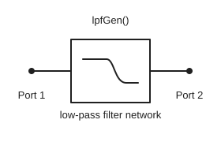

### Connecting n-Port Objects

These functions combine objects returned by the constructors:

| Function | Purpose |
| --- | --- |
| `nP.nodal(...connections)` | Connects arbitrary n-port objects by numbered nodes and declares external ports with `['out', ...]`. |
| `nP.cascade(...nPorts)` | Cascades two-port objects in order. |

Every returned n-port exposes `.cas(nextTwoPort)`, but it is valid only when both objects are two-ports with compatible frequency grids and reference impedances.

### Methods on Returned n-Port Objects

The public constructors return objects with these fields and methods:

| Member | Returns | Purpose |
| --- | --- | --- |
| `.spars` | Array | S-parameter rows shaped as `[frequency, s11, s12, ..., s1n, s21, ..., snn]`. |
| `.global` | Object | The analysis settings associated with the object. |
| `.setspars(rows)` | `undefined` | Replaces the S-parameter rows. |
| `.getspars()` | Array | Returns the S-parameter rows. |
| `.setglobal(settings)` | `undefined` | Associates global settings with the object. |
| `.getglobal()` | Object | Returns the associated global settings. |
| `.cas(nextTwoPort)` | n-port | Cascades this two-port with another two-port and returns a new two-port. |
| `.out(...selections)` | Array | Returns a numeric display table. |
| `.outTable(...selections)` | Array | Returns the same numeric output-table shape as `.out()`. |

An output selection has the case-sensitive form `sijSuffix`, where `i` is the response port, `j` is the excited port, and both must exist on the n-port. Valid suffixes are `mag`, `dB`, `ang`, `Re`, and `Im`; `ang` is returned in degrees. For example, `s21dB` is the magnitude in decibels at port 2 from excitation at port 1.

> **`.out()` selection example**
> ```javascript
> var table = network.out(
>     's11dB',
>     's21dB',
>     's11Re',
>     's11Im'
> );
> ```

The internal base constructor is not exported as `nP.nPort()`. Users create n-port objects through the public RF constructors listed above.

The library does not resample or reconcile networks during `.cas()`, `cascade()`, or `nodal()`. All participating objects must already have the same number and ordering of frequency points and compatible reference impedance.

### Method Chaining

Method chaining means calling a method on the object returned by the preceding method:

```javascript
var result = firstObject
    .firstMethod()
    .secondMethod()
    .thirdMethod();
```

nP supports method chaining on three object families:

| Object family | What continues the chain | What ends the chain |
| --- | --- | --- |
| Two-port n-port | `.cas(nextTwoPort)` returns a new two-port. | `.out()`, `.outTable()`, `.getspars()`, and `.getglobal()` return data rather than an n-port. |
| Complex number | Object-returning setters, arithmetic, copying, and complex hyperbolic methods. | Numeric accessors, magnitude, angle, and decibel methods return numbers. |
| Matrix | Every public Matrix method returns a Matrix object. | Reading the public `.m` field returns the underlying two-dimensional array. |

#### Two-Port n-Port Chaining

The `.cas()` method is the source of RF-network method chaining. It connects two two-ports in cascade and returns a new two-port, so another `.cas()` can follow it.

These public constructors return two-ports that can participate in a `.cas()` chain:

| Family | Chainable two-port constructors |
| --- | --- |
| Basic RLC | `R`, `L`, `C`, `seR`, `seL`, `seC`, `paR`, `paL`, `paC` |
| Internally series RLC | `seSeRL`, `paSeRL`, `seSeRC`, `paSeRC`, `seSeLC`, `paSeLC`, `seSeRLC`, `paSeRLC` |
| Internally parallel RLC | `sePaRL`, `paPaRL`, `sePaRC`, `paPaRC`, `sePaLC`, `paPaLC`, `sePaRLC`, `paPaRLC` |
| Transformer | `trf` |
| Ideal transmission components | `Shift90`, `Tlin` |
| Physical microstrip | `mlin`, `mstep`, `mbend`, `mtfr`, `mvia` |
| Other | `diode1N4148`, `lpfGen` |

One-port and multiport objects cannot validly participate in `.cas()`. This excludes `Open`, `Short`, `Load`, `Tee`, `Tee4`, `Tee5`, `trf4Port`, `Tclin`, `mclin`, `mtee`, `mcross`, and `mvgnd`.

`nP.cascade(...)` and `nP.nodal(...)` are standalone functions, not chainable methods:

- `nP.cascade(a, b, c)` is a convenience function that repeatedly applies `.cas()`.
- `nP.nodal(...)` solves an arbitrary node-connected topology.
- If `nP.nodal(...)` declares exactly two external ports, its returned two-port can begin a later `.cas()` chain.

Before cascading, make sure every object uses compatible `nP.global.fList` and `nP.global.Ro` values.

> **Two-port method chaining**
> ```npjs
> var g = nP.global;
> g.fList = g.fGen(1e9, 10e9, 11);
>
> var network = nP.R(25)
>     .cas(nP.L(5e-9))
>     .cas(nP.C(1e-12));
>
> var output = network.out('s11dB', 's21dB');
> console.log(output);
> ```

#### Complex-Number Chaining

These methods return a complex object, so another complex method can follow:

| Behavior | Chainable methods |
| --- | --- |
| Mutate and return the same object | `.set()`, `.setR()`, `.setI()` |
| Return a new complex object | `.add()`, `.sub()`, `.mul()`, `.div()`, `.inv()`, `.neg()`, `.copy()`, `.sinhCplx()`, `.coshCplx()` |

These methods return an ordinary number and therefore end the complex-object chain:

| Returned number | Chain-ending methods |
| --- | --- |
| Real or imaginary part | `.getR()`, `.getI()` |
| Magnitude or angle | `.mag()`, `.ang()` |
| Decibel value | `.mag10dB()`, `.mag20dB()` |

> **Complex-number method chaining**
> ```npjs
> var result = nP.complex(3, 4)
>     .add(nP.complex(1, -2))
>     .mul(nP.complex(2, 0))
>     .inv();
>
> console.log(result);
> console.log("magnitude = " + result.mag());
> ```

The final `.mag()` returns a number. A complex method such as `.add()` cannot follow it.

#### Matrix Chaining

Every public Matrix method returns a Matrix object:

| Behavior | Chainable Matrix methods |
| --- | --- |
| Set, create, or copy | `.set()`, `.dimension()`, `.copyMatrix()` |
| Real-matrix operations | `.add()`, `.sub()`, `.mul()`, `.solveGaussFB()`, `.invert()` |
| Complex-matrix operations | `.addCplx()`, `.subCplx()`, `.mulCplx()`, `.solveGaussFBCplx()`, `.invertCplx()` |

Use the real methods when every entry is a JavaScript number. Use the `Cplx` methods when entries are `nP.complex()` objects. Matrix dimensions must be compatible with the requested operation.

> **Real-matrix method chaining**
> ```npjs
> var identity = nP.matrix([
>     [1, 0],
>     [0, 1]
> ]);
>
> var result = nP.matrix([
>     [2, 0],
>     [0, 2]
> ])
>     .add(identity)
>     .mul(identity)
>     .invert();
>
> console.log(result.m);
> ```

Accessing `.m` returns the underlying two-dimensional JavaScript array and ends the Matrix-object chain.

### Complex Numbers

Create a complex number with:

```javascript
var z = nP.complex(real, imaginary);
```

Example:

```javascript
var z1 = nP.complex(3, 4);
```

The real and imaginary values are available as public numeric fields `.x` and `.y`.

In these tables, **Chainable: Yes** means the method returns a complex object that supports another complex method.

#### Complex Accessors and Mutators

| Method | Purpose | Chainable |
| --- | --- | :---: |
| `.set(real, imaginary)` | Mutates both parts and returns the same object. Normally used internally by `nP.complex()`. | Yes |
| `.getR()` | Returns the real part. | No |
| `.getI()` | Returns the imaginary part. | No |
| `.setR(value)` | Mutates the real part and returns the same object. | Yes |
| `.setI(value)` | Mutates the imaginary part and returns the same object. | Yes |

#### Complex Arithmetic

These methods return new complex objects rather than changing the original value:

| Method | Purpose | Chainable |
| --- | --- | :---: |
| `.add(z)` | Addition. | Yes |
| `.sub(z)` | Subtraction. | Yes |
| `.mul(z)` | Multiplication. | Yes |
| `.div(z)` | Division. | Yes |
| `.inv()` | Multiplicative inverse. | Yes |
| `.neg()` | Additive inverse. | Yes |
| `.copy()` | Independent copy. | Yes |

#### Complex Magnitude, Angle, and Hyperbolic Functions

| Method | Purpose | Chainable |
| --- | --- | :---: |
| `.mag()` | Magnitude. | No |
| `.ang()` | Phase angle in degrees. | No |
| `.mag10dB()` | `10 log10` of the magnitude. | No |
| `.mag20dB()` | `20 log10` of the magnitude. | No |
| `.sinhCplx()` | Complex hyperbolic sine. | Yes |
| `.coshCplx()` | Complex hyperbolic cosine. | Yes |

> **Complex-number example**
> ```npjs
> var z1 = nP.complex(3, 4);
> var z2 = nP.complex(1, -2);
>
> console.log("magnitude = " + z1.mag());
> console.log("angle = " + z1.ang());
> console.log(z1.add(z2));
> ```

### Matrices

Create a matrix from a two-dimensional JavaScript array:

```javascript
var a = nP.matrix([
    [1, 2],
    [3, 4]
]);
```

The two-dimensional array is available in the public `.m` field.

In these tables, **Chainable: Yes** means the function or method returns a Matrix object. Functions that return a plain JavaScript array are marked **No**.

Matrix operations assume nonempty rectangular arrays with compatible dimensions:

- `.add()`, `.sub()`, `.addCplx()`, and `.subCplx()` require equal dimensions.
- `.mul()` and `.mulCplx()` require the left column count to equal the right row count.
- `.invert()` and `.invertCplx()` require a square, nonsingular matrix.
- `.solveGaussFB()` and `.solveGaussFBCplx()` expect an augmented system with `n` rows and `n + 1` columns and return the solution as an `n × 1` Matrix.

nP `0.0.48` does not perform comprehensive dimension, shape, or singularity validation before these calculations. Verify inputs before relying on a result.

#### Matrix Construction Helpers

| Function or method | Purpose | Chainable |
| --- | --- | :---: |
| `nP.matrix(array2d)` | Creates a matrix object from a two-dimensional array. | Yes |
| `nP.dim(rows, cols, initial)` | Creates a two-dimensional array filled with an initial value. | No |
| `nP.dup(array2d)` | Duplicates the row arrays of a two-dimensional array. | No |
| `.set(array2d)` | Replaces `.m` and returns the same matrix object. Normally used internally by `nP.matrix()`. | Yes |
| `.dimension(rows, cols, initial)` | Creates a matrix object with the requested dimensions. | Yes |
| `.copyMatrix()` | Returns a copied matrix object. | Yes |

#### Real Matrix Methods

Use these when every entry is a JavaScript number:

| Method | Purpose | Chainable |
| --- | --- | :---: |
| `.add(matrixB)` | Matrix addition. | Yes |
| `.sub(matrixB)` | Matrix subtraction. | Yes |
| `.mul(matrixB)` | Matrix multiplication. | Yes |
| `.solveGaussFB()` | Solves a real augmented matrix and returns the solution column. | Yes |
| `.invert()` | Matrix inverse. | Yes |

#### Complex Matrix Methods

Use these when the entries are `nP.complex()` objects:

| Method | Purpose | Chainable |
| --- | --- | :---: |
| `.addCplx(matrixB)` | Complex matrix addition. | Yes |
| `.subCplx(matrixB)` | Complex matrix subtraction. | Yes |
| `.mulCplx(matrixB)` | Complex matrix multiplication. | Yes |
| `.solveGaussFBCplx()` | Solves a complex augmented matrix and returns the solution column. | Yes |
| `.invertCplx()` | Complex matrix inverse. | Yes |

The solving and inversion methods operate on duplicated data and return new matrix objects. They do not intentionally overwrite the caller's matrix.

> **Matrix-inversion example**
> ```npjs
> var a = nP.matrix([
>     [1, 2],
>     [3, 4]
> ]);
>
> var inverse = a.invert();
>
> console.log(inverse.m);
> ```

### Display Functions and Their Returned APIs

`nP.lineChart()`, `nP.lineTable()`, and `nP.smithChart()` return small API objects after rendering their display. Each API provides:

- DOM or SVG element handles for advanced inspection or customization.
- Setter functions that apply styles to selected parts of the display.

| Display function | Element handles | Style setters | API object chainable |
| --- | ---: | ---: | :---: |
| `nP.lineChart(options)` | 12 | 12 | No |
| `nP.lineTable(options)` | 7 | 5 | No |
| `nP.smithChart(options)` | 9 | 5 | No |

A style setter accepts either:

```javascript
var style = { fill: "red", fontStyle: "italic" };
```

or a CSS declaration string:

```javascript
var style = "fill:red; font-style:italic;";
```

The setters return `undefined`, not the API object. Call them separately rather than chaining them.

> **`lineChart()` returned API**
> **Element handles**
>
> | Member | Returned element |
> | --- | --- |
> | `.container` | Display container element. |
> | `.svg` | Root SVG element. |
> | `.chartBackground` | Chart-background element. |
> | `.plotBorder` | Plot-border element. |
> | `.txtChartTitle` | Chart-title text element. |
> | `.txtXAxisTitle` | X-axis-title text element. |
> | `.txtYAxisTitle` | Y-axis-title text element. |
> | `.txtChartLabels` | Array of trace-label text elements. |
> | `.xAxisGroup` | X-axis SVG group. |
> | `.yAxisGroup` | Y-axis SVG group. |
> | `.xGridGroup` | X-grid SVG group. |
> | `.yGridGroup` | Y-grid SVG group. |
>
> **Style setters**
>
> | Setter | Styles |
> | --- | --- |
> | `.setTxtChartTitleStyle(style)` | Chart-title text. |
> | `.setChartBackgroundStyle(style)` | Chart background. |
> | `.setPlotBorderStyle(style)` | Plot border. |
> | `.setTxtXAxisTitleStyle(style)` | X-axis-title text. |
> | `.setTxtXAxisNumbersStyle(style)` | X-axis tick-number text. |
> | `.setXAxisLineStyle(style)` | X-axis path and tick lines. |
> | `.setXGridLineStyle(style)` | Vertical grid lines. |
> | `.setTxtYAxisTitleStyle(style)` | Y-axis-title text. |
> | `.setTxtYAxisNumbersStyle(style)` | Y-axis tick-number text. |
> | `.setYAxisLineStyle(style)` | Y-axis path and tick lines. |
> | `.setYGridLineStyle(style)` | Horizontal grid lines. |
> | `.setTxtChartLabelsStyle(style)` | Trace-label text. |

> **`lineTable()` returned API**
> **Element handles**
>
> | Member | Returned element |
> | --- | --- |
> | `.container` | Display container element. |
> | `.svg` | Root SVG element. |
> | `.tableBackground` | Table-background element. |
> | `.tableBorder` | Outer table-border element. |
> | `.txtTableTitle` | Table-title text element. |
> | `.txtHeaders` | Array of header text elements. |
> | `.txtData` | Array of data-cell text elements. |
>
> **Style setters**
>
> | Setter | Styles |
> | --- | --- |
> | `.setTxtTableTitleStyle(style)` | Table-title text. |
> | `.setTableBackgroundStyle(style)` | Table background. |
> | `.setTableBorderStyle(style)` | Outer table border. |
> | `.setTxtTableHeadersStyle(style)` | Header text. |
> | `.setTxtTableDataStyle(style)` | Data-cell text. |

> **`smithChart()` returned API**
> **Element handles**
>
> | Member | Returned element |
> | --- | --- |
> | `.container` | Display container element. |
> | `.svg` | Root SVG element. |
> | `.chartBackground` | Chart-background element. |
> | `.txtChartTitle` | Chart-title text element. |
> | `.unitCircle` | Smith-chart unit-circle element. |
> | `.smithGridGroup` | Smith-grid SVG group. |
> | `.traceGroup` | Trace SVG group. |
> | `.labelGroup` | Trace-label SVG group. |
> | `.txtChartLabels` | Array of trace-label text elements. |
>
> **Style setters**
>
> | Setter | Styles |
> | --- | --- |
> | `.setTxtChartTitleStyle(style)` | Chart-title text. |
> | `.setChartBackgroundStyle(style)` | Chart background. |
> | `.setUnitCircleStyle(style)` | Smith-chart unit circle. |
> | `.setSmithGridStyle(style)` | Smith-chart grid circles and lines. |
> | `.setTxtChartLabelsStyle(style)` | Trace-label text. |

> **Display API styling**
> ```npjs
> var g = nP.global;
> g.fList = g.fGen(1e9, 10e9, 11);
>
> var output = nP.R(25).out('s11dB', 's21dB');
> var chartApi = nP.lineChart({
>     inputTable: [output],
>     chartTitle: "Styled resistor output"
> });
>
> chartApi.setTxtChartTitleStyle({
>     fill: "darkred",
>     fontStyle: "italic"
> });
>
> chartApi.setPlotBorderStyle("stroke:darkred; stroke-width:2;");
> ```

The element handles are an advanced escape hatch. Prefer display options and the returned style setters for ordinary customization.

### Related Public APIs

The same nP `0.0.48` bundle also exports these global settings:

| Member | Initial value or signature | Purpose |
| --- | --- | --- |
| `nP.global.fList` | `[2e9]` | Active frequency list in hertz. |
| `nP.global.Ro` | `50` | Reference impedance in ohms. |
| `nP.global.Temp` | `293` | Analysis temperature in kelvins. |
| `nP.global.fGen()` | `(fStart, fStop, points)` | Returns a linearly spaced frequency array including both endpoints. Use at least two points. |
| `nP.version` | `"0.0.48"` | Bundled nP library version string. |

`nP.log(input)` is also exported, but it is a legacy browser-page helper that looks for an older page-level output element. Inside an Obsidian `npjs` block, use `console.log(input)` so the message appears in that block's console pane.

Return to [the start of the learning guide](learning-guide/1%20%22Hello,%20nPort%22.md), or open [the display-options lesson](learning-guide/6%20Display%20Input%20Objects.md).
